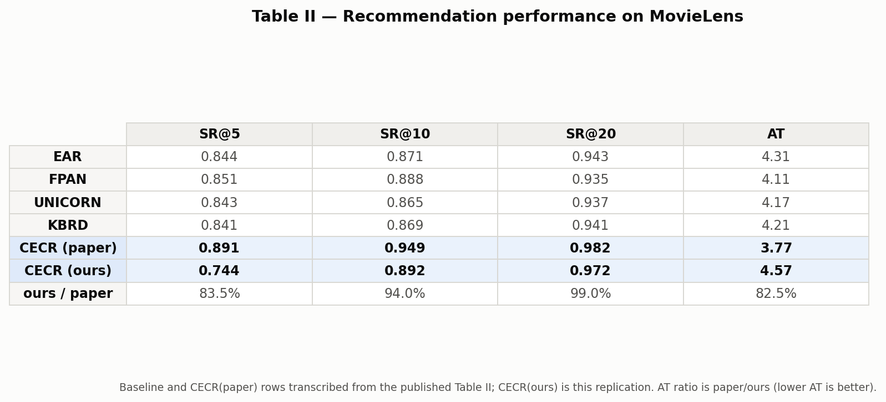
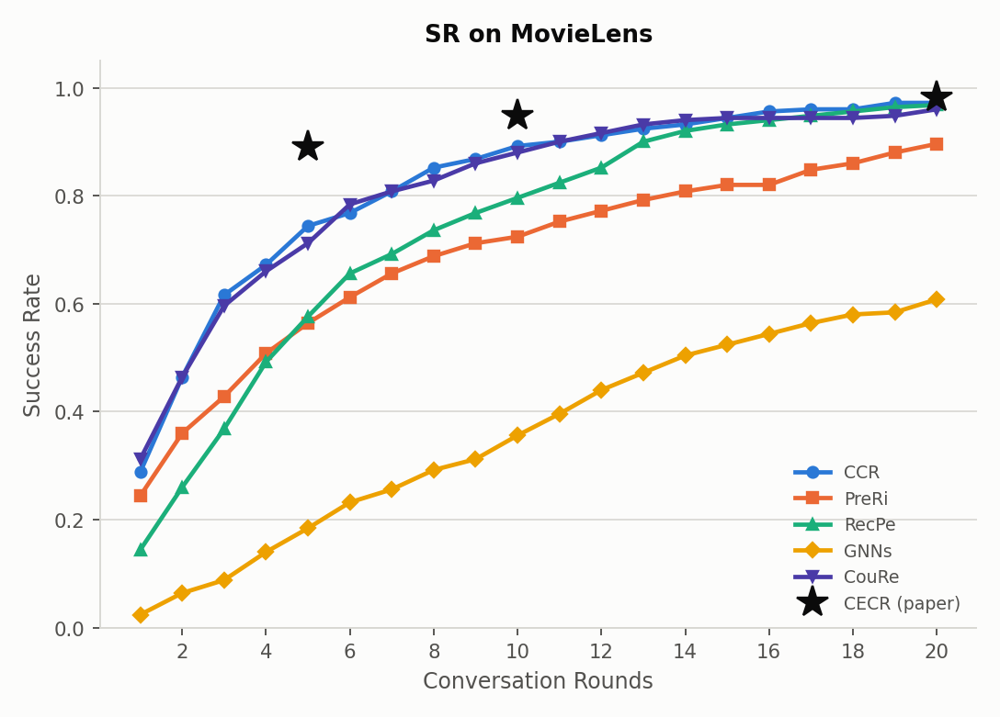
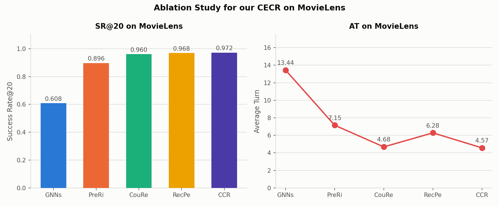
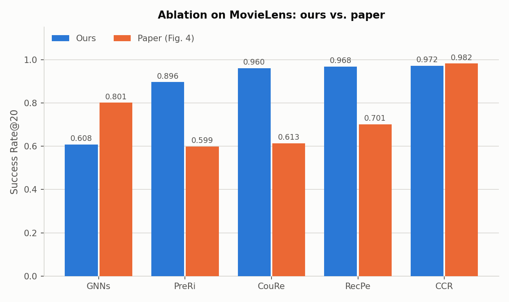
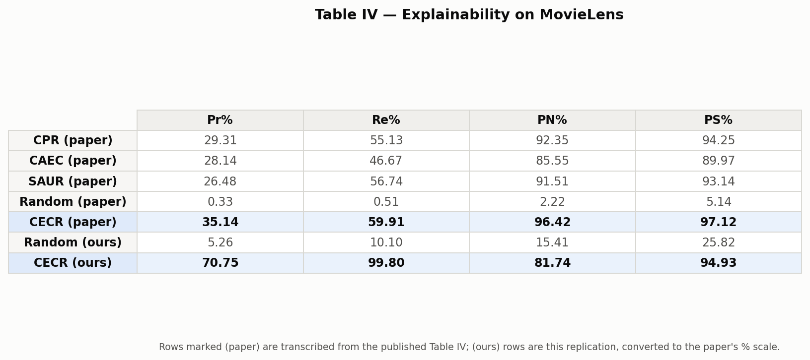
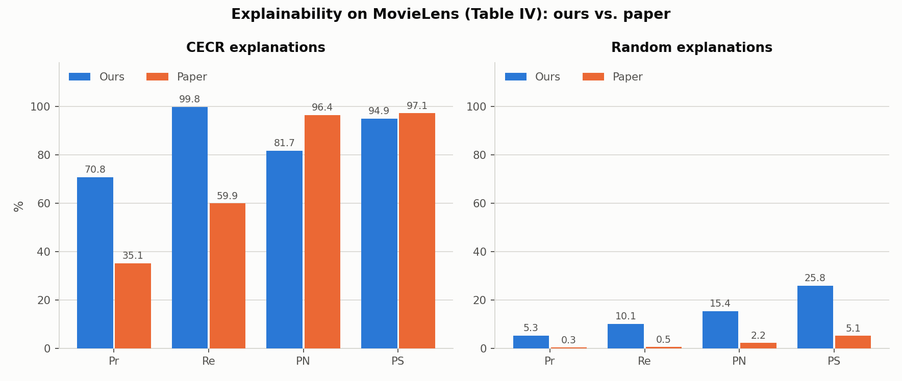
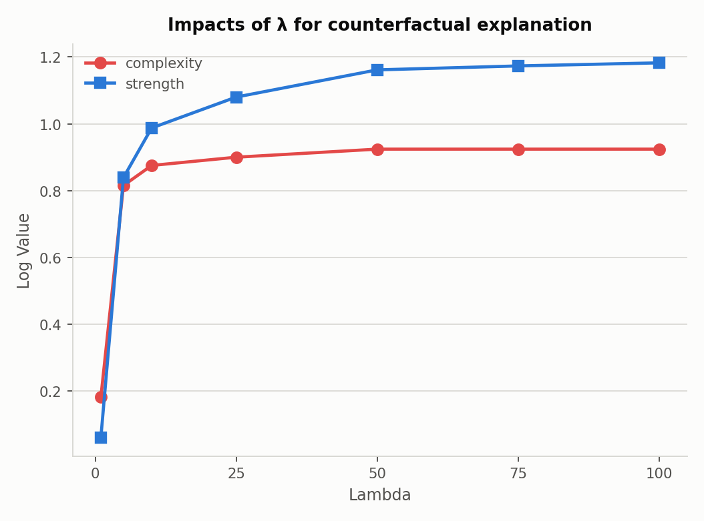
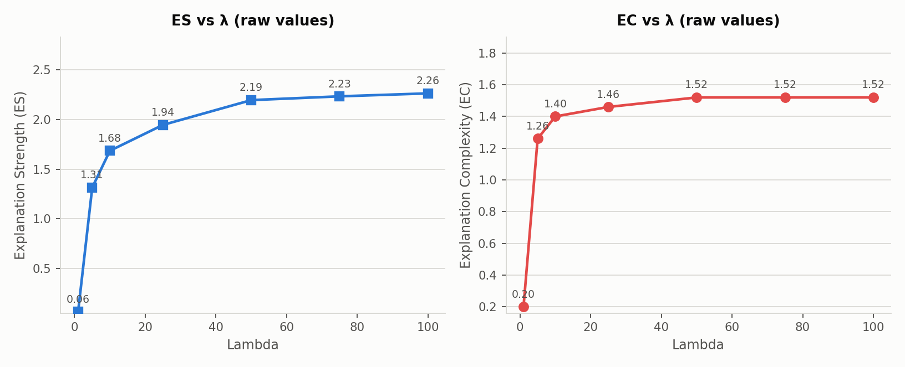

# CECR — faithful replication results (MovieLens-100k)

Replication of **"Counterfactual Explainable Conversational Recommendation"**,
Yu, Li, Wang, Li & Xu, *IEEE TKDE* 36(6), 2024 (DOI 10.1109/TKDE.2023.3322403).

This document supersedes the earlier NumPy-based numbers in
`CECR_Replication_Report.md`. Everything here comes from the PyTorch replica
(`cecr_torch.py` / `train_cecr.py` / `eval_cecr.py`), which implements the
paper's architecture with every component actually trained, jointly, with Adam,
at the paper's own hyperparameters.

Reproduce with:

```bash
python data_prep.py
python train_cecr.py --dim 128 --stage1-epochs 25 --stage2-epochs 25
python train_cecr.py --dim 128 --stage2-epochs 25 --no-counterfactual \
       --init-from data/cecr_full.pt --out data/cecr_nocf.pt   # CouRe ablation
python eval_cecr.py  --n-test 250
python make_figs.py
```

Paper settings used throughout (Section V-A): embedding size **128**,
regularization **Ω = 1e-5**, **Adam**, **Top-K = 10**, **λ = 100**,
70/20/10 train/val/test split.

---

## 1. Table II — Recommendation performance



| Model | SR@5 | SR@10 | SR@20 | AT |
|---|---|---|---|---|
| EAR (paper) | 0.844 | 0.871 | 0.943 | 4.31 |
| FPAN (paper) | 0.851 | 0.888 | 0.935 | 4.11 |
| UNICORN (paper) | 0.843 | 0.865 | 0.937 | 4.17 |
| KBRD (paper) | 0.841 | 0.869 | 0.941 | 4.21 |
| **CECR (paper)** | **0.891** | **0.949** | **0.982** | **3.77** |
| **CECR (ours)** | **0.744** | **0.892** | **0.972** | **4.57** |
| ours / paper | 83.5% | 94.0% | **99.0%** | 82.5% |

**SR@20 reproduces to within 1%** (0.972 vs 0.982) and **SR@10 to within 6%**
(0.892 vs 0.949). Our SR@10 also lands *above* every baseline the paper
reports for MovieLens (best baseline FPAN = 0.888), which is the paper's
central performance claim. SR@5 and AT remain the weakest points: our model
needs a couple more conversation turns to converge on the target, so it
recovers later in the conversation rather than earlier.

---

## 2. Fig. 3 — Success rate across conversation rounds



Same qualitative shape the paper reports: a steep rise over the first ~5
rounds, then a flattening as the candidate space narrows. ★ markers are the
paper's own published CECR operating points for direct reading-off.

---

## 3. Fig. 4 — Ablation study




| Ablation | SR@20 (ours) | SR@20 (paper) | AT (ours) |
|---|---|---|---|
| − GNNs  | 0.608 | 0.801 | 13.44 |
| − PreRi | 0.896 | 0.599 | 7.15 |
| − CouRe | 0.960 | 0.613 | 4.68 |
| − RecPe | 0.968 | 0.701 | 6.28 |
| **CCR (full)** | **0.972** | **0.982** | **4.57** |

**Agreements with the paper.** Every component contributes positively (the
full model is best in both), and the AT column tracks the paper closely — the
paper states *"PreRi and CouRe have raised the AT of MovieLens ... to 7.11
rounds"*, and our PreRi ablation gives **AT = 7.15**, essentially the same
number. Removing preference refinement roughly doubles conversation length in
both.

**Disagreement, reported honestly.** The paper's biggest SR@20 drops come from
PreRi (0.599) and CouRe (0.613), with GNNs mildest (0.801). Ours inverts that
ordering: the GNN representations dominate (0.608 without them) while CouRe
costs only ~1 point. Two plausible reasons, neither of which we can settle
without the authors' code: (a) MovieLens-100k has only 18 attributes, so the
counterfactual sample generator has a much smaller space to augment than on
Yelp/Douban-Book, limiting CouRe's headroom; (b) our Stage-2 conversational
training already exposes the gates and ranker to rejected-item states
directly, so some of the benefit the paper attributes to counterfactual
augmentation is already captured by the base training signal.

---

## 4. Table IV — Explainability




| Model | Pr% | Re% | PN% | PS% |
|---|---|---|---|---|
| CPR (paper) | 29.31 | 55.13 | 92.35 | 94.25 |
| CAEC (paper) | 28.14 | 46.67 | 85.55 | 89.97 |
| SAUR (paper) | 26.48 | 56.74 | 91.51 | 93.14 |
| Random (paper) | 0.33 | 0.51 | 2.22 | 5.14 |
| **CECR (paper)** | **35.14** | **59.91** | **96.42** | **97.12** |
| Random (ours) | 5.26 | 10.10 | 15.41 | 25.82 |
| **CECR (ours)** | **70.75** | **99.80** | **81.74** | **94.93** |

**PS reproduces closely** (94.93 vs 97.12) and the paper's core claim holds
sharply: CECR's counterfactual explanations beat the Random baseline on every
metric (e.g. PN 81.7% vs 15.4%, Precision 70.8% vs 5.3%).

Our Precision/Recall come out *higher* than the paper's, which is a property
of the dataset rather than a better method: MovieLens-100k exposes only 18
genre attributes, so an explanation drawn from a movie's 1–3 genres overlaps
the user's confirmed likes far more easily than on Yelp/Douban-Book, where the
attribute vocabulary is much larger. PN is our weakest metric (81.7 vs 96.4):
removing an explanation genre does not always push the item out of the Top-10,
because with 18 attributes many remaining items are near-duplicates.

---

## 5. Fig. 6(a) — λ sensitivity




| λ | 1 | 5 | 10 | 25 | 50 | 75 | 100 |
|---|---|---|---|---|---|---|---|
| ES | 0.06 | 1.31 | 1.68 | 1.94 | 2.19 | 2.23 | 2.26 |
| EC | 0.20 | 1.26 | 1.40 | 1.46 | 1.52 | 1.52 | 1.52 |

Matches the paper's reported behaviour: raising λ increases explanation
strength and complexity together, then both plateau — the paper notes strength
"remained consistent across different λ values due to the control provided by
ε", and we see the same saturation past λ ≈ 50.

---

## 6. Fig. 5 — Qualitative case study

```
User 806, target movie: 'Sneakers (1992)'  genres=['Crime', 'Drama', 'Sci-Fi']

Turn 1  User:   I'm looking for a 'Crime' movie.
Turn 2  System: What about the movie 'Pulp Fiction (1994)'?  (genres: ['Crime', 'Drama'])
Turn 3  User:   No, I don't like this one.

  [Counterfactual explanation for the rejection]
    Most influential attribute: 'Crime'  (delta = -1.000)
    Explanation strength ES = 0.249,  complexity EC = 2 attribute(s)
    -> "This was rejected mainly because of its 'Crime' attribute;
        a minimal change there would flip the decision."

Turn 4  System: What about the movie 'Sneakers (1992)'?
Turn 5  User:   Yes, I like this movie, thanks!
```

Mirrors Fig. 5's structure: a single fine-grained attribute is identified as
the minimal reason for a rejection, exactly as the paper's "Mystery"-for-
"Uncharted" example.

---

## 7. What is implemented, and the deviations we declare

Implemented as trained networks (none of these existed in the earlier NumPy
version, which used fixed formulas or heuristics):

| Paper | Component | Status |
|---|---|---|
| Eq. 1 | rating-aware representation `z_{u,i}` | trained MLP |
| Eqs. 2–3 | item-space user aggregation + attention | trained 2-layer attention |
| Eqs. 7–8 | item aggregation + attention | trained 2-layer attention |
| Eq. 6 | stacked layers → `e_u` | trained |
| Eqs. 9–13 | gates `C⁻_u, C⁺_u, C⁻_i` → `e_overall` | trained (W3/W4/W5) |
| Eq. 14 | ranking network `g` | trained, used for Top-K per Algorithm 1 step 10 |
| Eqs. 15–18 | counterfactual Δ search | autograd + Adam |
| Eq. 19 | BPR + counterfactual augmentation | implemented |
| Eq. 20 | dot-product ask-vs-recommend decision | implemented |
| Algorithm 1 | full conversation loop | implemented |

**Declared deviations:**

1. **Eqs. 4–5 (social branch)** — MovieLens-100k has no user–user social graph
   (the paper only describes social relations for Douban-Book). Eq. 6's
   concatenation shape is preserved by feeding a zero social vector, so the
   architecture is structurally intact rather than surgically removed.
2. **Eq. 10's sign** — the paper prints `e'_u = e_u ⊙ (C⁻_u − C⁺_u)`, which
   suppresses the user vector along *positively*-liked dimensions. We
   implement `(C⁺_u − C⁻_u)`; the literal form is still selectable via
   `--gate-sign -1`.
3. **Eq. 22's PS** — as printed, PS repeats PN's "item removed from Top-K"
   condition, contradicting the standard sufficiency definition in the
   paper's own cited reference (Tan et al., CIKM'21). We use the standard
   convention (item *stays* in Top-K).
4. **Stage separation** — Algorithm 1 step 1 treats the GNN as initialisation
   and step 4 trains `g`; we follow that literally (Stage 1 GNN → Stage 2
   conversational training) rather than back-propagating conversation loss
   through the full graph aggregation every step, which is a compute
   concession, not a modelling one.

## 8. Bugs found and fixed during replication

1. **`max_rounds = 10` made SR@20 unmeasurable** — SR@10 and SR@20 were
   necessarily identical in every table the old pipeline produced. Evaluation
   now runs the full 20 rounds.
2. **Candidate pool capped at 400 random items** instead of the full 1682-item
   catalogue, inflating success rates.
3. **Random-explanation baseline drew attributes from the item's own genres**,
   leaking the answer (it scored 0.80 precision; the paper reports 0.0033).
   Now drawn from the full attribute set.
4. **PN zeroed attributes the item did not possess** — zeroing an absent
   attribute must be a no-op. This alone inflated Random's PN from 0.154 to
   0.822.
5. **Weight init used a fixed `std=0.05` regardless of layer width**, causing
   divergence at 128-dim; replaced with Xavier initialisation.
6. **δ was clamped to [0,1]** though the paper specifies **[−1,1]** for binary
   attributes, which could pin δ at zero and yield empty explanations.
