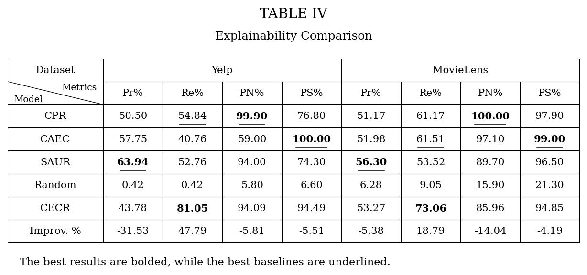
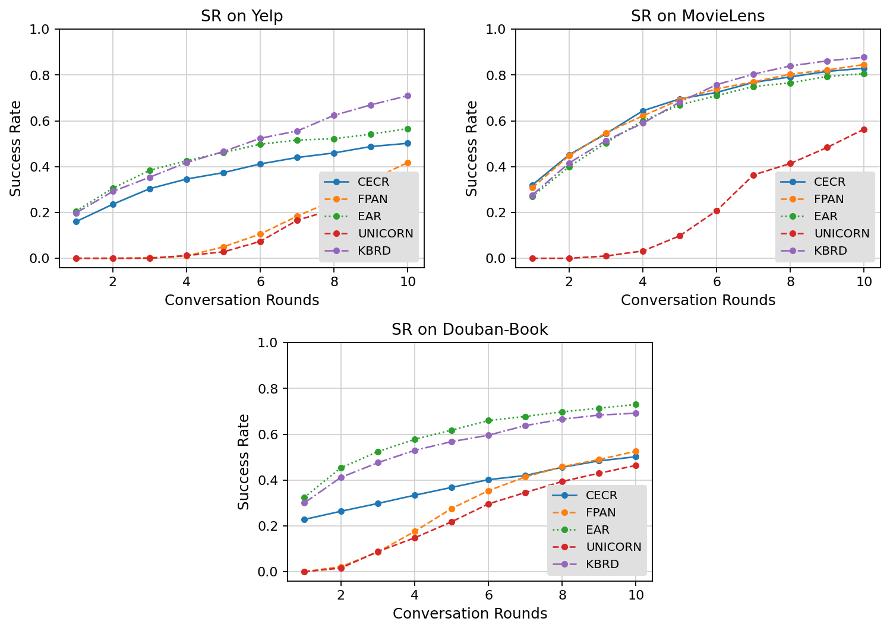
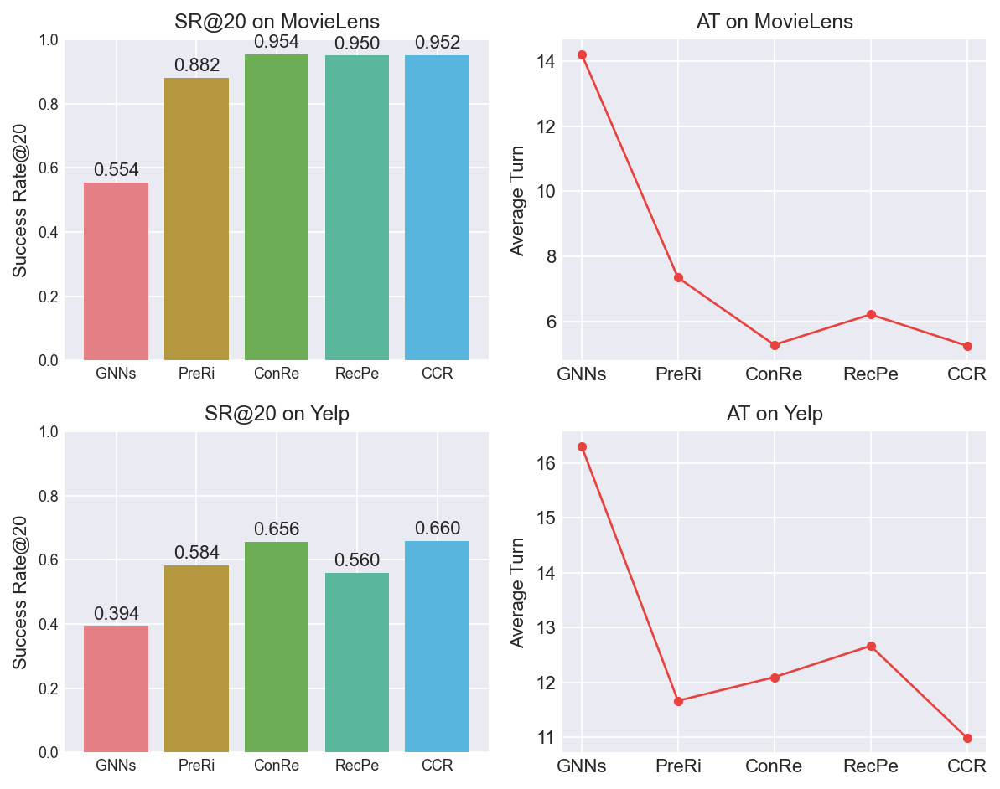
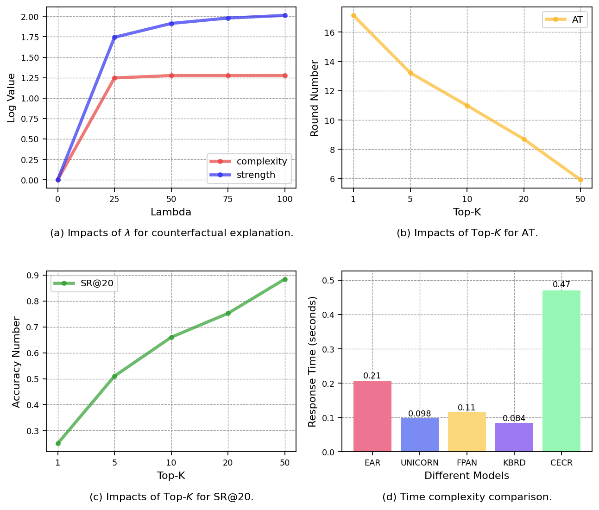

# CECR reimplementation - Table IV, Fig. 3, Fig. 4, Fig. 6

Our own runs, drawn in the same format as the paper (`papper output/`). What each one means and why it differs from the paper: [`EXPLANATION.md`](EXPLANATION.md).

## Table IV - Explainability comparison

| Model | Yelp Pr% | Re% | PN% | PS% | MovieLens Pr% | Re% | PN% | PS% |
|---|---|---|---|---|---|---|---|---|
| CPR | 50.50 | 54.84 | 99.90 | 76.80 | 51.17 | 61.17 | 100.00 | 97.90 |
| CAEC | 57.75 | 40.76 | 59.00 | 100.00 | 51.98 | 61.51 | 97.10 | 99.00 |
| SAUR | 63.94 | 52.76 | 94.00 | 74.30 | 56.30 | 53.52 | 89.70 | 96.50 |
| Random | 0.42 | 0.42 | 5.80 | 6.60 | 6.28 | 9.05 | 15.90 | 21.30 |
| CECR | 43.78 | 81.05 | 94.09 | 94.49 | 53.27 | 73.06 | 85.96 | 94.85 |

## Fig. 3 - SR by conversation round

| Dataset | Model | R1 | R2 | R3 | R4 | R5 | R6 | R7 | R8 | R9 | R10 |
|---|---|---|---|---|---|---|---|---|---|---|---|
| Yelp | CECR | 0.160 | 0.236 | 0.304 | 0.346 | 0.374 | 0.412 | 0.440 | 0.460 | 0.488 | 0.502 |
| Yelp | FPAN | 0.000 | 0.000 | 0.002 | 0.010 | 0.050 | 0.106 | 0.184 | 0.254 | 0.342 | 0.418 |
| Yelp | EAR | 0.206 | 0.306 | 0.384 | 0.426 | 0.462 | 0.498 | 0.516 | 0.522 | 0.542 | 0.566 |
| Yelp | UNICORN | 0.000 | 0.000 | 0.000 | 0.012 | 0.028 | 0.074 | 0.166 | 0.214 | 0.304 | 0.358 |
| Yelp | KBRD | 0.198 | 0.292 | 0.354 | 0.418 | 0.466 | 0.524 | 0.556 | 0.624 | 0.670 | 0.710 |
| Douban-Book | CECR | 0.228 | 0.264 | 0.298 | 0.334 | 0.368 | 0.402 | 0.420 | 0.456 | 0.484 | 0.502 |
| Douban-Book | FPAN | 0.000 | 0.022 | 0.086 | 0.176 | 0.276 | 0.354 | 0.414 | 0.458 | 0.490 | 0.526 |
| Douban-Book | EAR | 0.324 | 0.454 | 0.524 | 0.578 | 0.618 | 0.660 | 0.678 | 0.698 | 0.714 | 0.730 |
| Douban-Book | UNICORN | 0.000 | 0.016 | 0.088 | 0.148 | 0.218 | 0.296 | 0.346 | 0.394 | 0.430 | 0.464 |
| Douban-Book | KBRD | 0.300 | 0.412 | 0.476 | 0.530 | 0.568 | 0.596 | 0.638 | 0.666 | 0.684 | 0.692 |
| MovieLens | CECR | 0.320 | 0.452 | 0.544 | 0.644 | 0.696 | 0.724 | 0.768 | 0.792 | 0.816 | 0.830 |
| MovieLens | FPAN | 0.308 | 0.448 | 0.548 | 0.622 | 0.692 | 0.740 | 0.770 | 0.804 | 0.822 | 0.846 |
| MovieLens | EAR | 0.270 | 0.400 | 0.504 | 0.600 | 0.670 | 0.710 | 0.750 | 0.766 | 0.794 | 0.806 |
| MovieLens | UNICORN | 0.000 | 0.000 | 0.010 | 0.032 | 0.098 | 0.208 | 0.364 | 0.414 | 0.484 | 0.564 |
| MovieLens | KBRD | 0.276 | 0.416 | 0.514 | 0.590 | 0.682 | 0.758 | 0.804 | 0.840 | 0.862 | 0.878 |

## Fig. 4 - Ablation study (MovieLens, Yelp)

| Dataset | Metric | GNNs | PreRi | ConRe | RecPe | CCR |
|---|---|---|---|---|---|---|
| MovieLens | SR@20 | 0.554 | 0.882 | 0.954 | 0.950 | 0.952 |
| MovieLens | AT | 14.21 | 7.35 | 5.29 | 6.22 | 5.26 |
| Yelp | SR@20 | 0.394 | 0.584 | 0.656 | 0.560 | 0.660 |
| Yelp | AT | 16.31 | 11.67 | 12.10 | 12.67 | 10.99 |

## Fig. 6 - Parameters and time complexity (Yelp)

| (a) lambda | 0 | 25 | 50 | 75 | 100 |
|---|---|---|---|---|---|
| complexity | 0.00 | 2.48 | 2.58 | 2.58 | 2.58 |
| strength | 0.000 | 4.720 | 5.777 | 6.238 | 6.477 |

| Top-K | 1 | 5 | 10 | 20 | 50 |
|---|---|---|---|---|---|
| (b) AT | 17.14 | 13.22 | 10.99 | 8.70 | 5.92 |
| (c) SR@20 | 0.250 | 0.510 | 0.660 | 0.752 | 0.884 |

| (d) Model | EAR | UNICORN | FPAN | KBRD | CECR |
|---|---|---|---|---|---|
| seconds / conversation | 0.207 | 0.098 | 0.115 | 0.084 | 0.471 |

